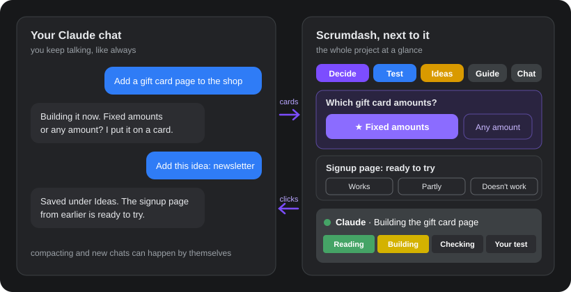
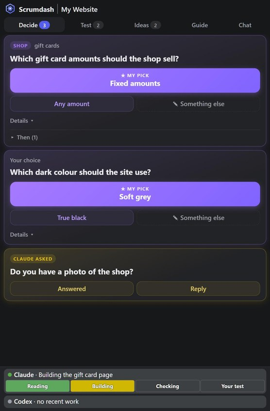
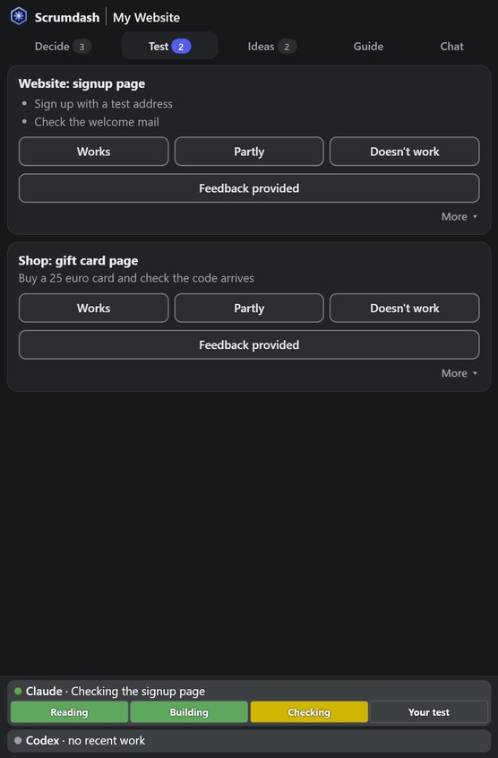
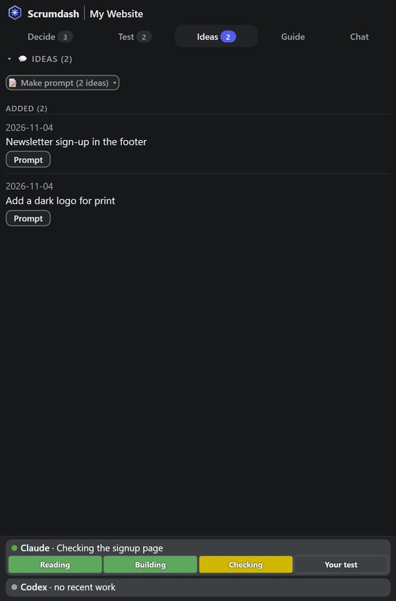
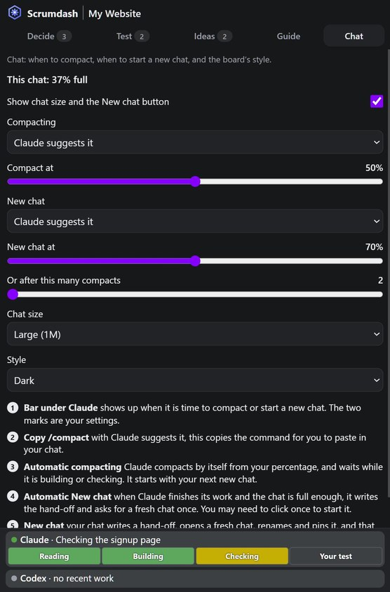
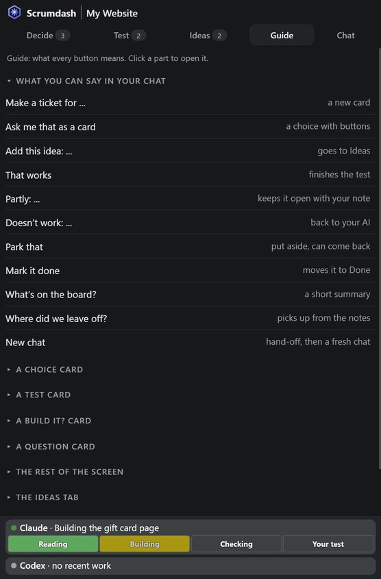

<h1 align="center">Scrumdash</h1>

A project board that sits next to your Claude Code chat. You keep chatting with Claude. Scrumdash keeps the overview.

## Why it exists

Chatting with Claude is great for building. On a big project, though, a chat alone gets hard to follow:

- A question Claude asked you scrolls away under new messages.
- You lose track of what is ready to try and what you already tested.
- Ideas you mention halfway through a task get lost.
- The chat fills up. You have to remember to *compact* it (Claude shrinks the conversation into a summary so the chat can keep going), or to start a fresh chat without losing the thread.

Scrumdash is a **hybrid**: you still talk to Claude in the chat, exactly as before. Next to it, in the desktop app's browser pane (a panel that opens beside the chat), a small board shows the parts of the project that need you: choices, things to test, ideas. You answer with one click, or just keep typing. It also takes some of the chat chores off your hands. It shows what Claude is doing right now, and it can compact or move to a fresh chat at a good moment, with a *hand-off* (a short note of where you are, for the next chat) so nothing is lost.

It runs on your own computer: no account, no cloud, nothing to host. Your cards are plain text files in your project.

*Not a scrum tool: no sprints, no stand-ups, no points. Just what needs you.*

## What each part does

<table>
<tr>
<td width="320"></td>
<td>

### Decide
Questions Claude needs you to answer, as cards with buttons. Claude's own pick is the big button; the others sit under it, with **Something else** for your own answer. Answering in the chat works just as well: Claude closes the card itself.

Also here: **Build it?** cards for new work, and yellow **Claude asked** cards: press **Answered** once you replied in chat, or **Reply** to answer from the board. **Then** folds away the next steps of the same task.

</td>
</tr>
<tr>
<td></td>
<td>

### Test
Everything that is ready for you to try, with what to check as short bullet points; builds from the last 24 hours come first. Press **Works**, **Partly** or **Doesn't work**, or **Feedback provided** when you already told Claude in the chat. Claude picks up your answer the next time it replies, so a test result never gets lost in the chat.

</td>
</tr>
<tr>
<td></td>
<td>

### Ideas
Every idea you mentioned that is not built yet, so ideas you have mid-task are kept without derailing the current work (for example: "Add this idea: ..."). **Prompt** on an idea, or **Make prompt** for all of them, gives a message you can paste into a chat when you are ready.

</td>
</tr>
<tr>
<td></td>
<td>

### Chat
How full this chat is, and what happens when it fills up. For **compacting** and for **New chat** you choose **Claude suggests it** or **Automatic, at a good moment**. Automatic waits while Claude is building or checking, unless the chat is almost full. The sliders set how full the chat gets first. A new chat starts from a short hand-off, so the next chat knows where you left off. Also the chat size (Large or Normal) and the board's style: same as your computer, dark, light, or a warm cream.

</td>
</tr>
<tr>
<td></td>
<td>

### Guide
What every button means, and what you can say in the chat. You can also just ask Claude.

### The bar at the bottom
What Claude is doing right now: **Reading**, **Building**, **Checking**, or **Your test**, plus a few words. It follows what Claude really does, and says *idle* when Claude is done. Each chat sees its own bar.

The second line is for Codex (OpenAI's coding assistant), if you also use it in the same folder. Without it, it just says *no recent work*.

</td>
</tr>
</table>

## Get started

You need the [Claude desktop app](https://claude.ai/download), signed in with a Claude plan that includes Claude Code. On Windows that is all: the download carries its own small copy of Python in `app/python`, and its licence is in that folder. On Mac and Linux you also need [Python 3.10 or newer](https://www.python.org/downloads/).

1. Download `scrumdash-windows.zip` or `scrumdash-mac-linux.zip` from [Releases](https://github.com/Ai-Slop-Productions/scrumdash/releases) and unzip it anywhere.
2. Double-click `Scrumdash.exe` (Windows). On Mac or Linux, open Terminal, type `sh ` and drag `scrumdash.sh` into the window, then press Enter. Keep the `app` folder next to it. A small Scrumdash window opens.
3. In the small window, press **I'm starting something new** (give it a name, it makes the folder in Documents) or **I already have a project** (choose the folder).
4. Scrumdash asks the Claude app to open a new chat in that folder, in the **Code** section of the app. Look for it in the chat list, because it may not come to the front by itself. Its first message is already typed: if Claude asks about the folder, say yes, then press send. The board opens next to the chat.

If no chat appears, start a new chat in that folder yourself, in the Code section.

**Already in a chat?** Once you have opened Scrumdash one time, type `/scrumdash` in any chat in the Code section. The board opens next to that chat, for the folder that chat works in. Claude may ask permission to run one command: say yes.

Windows may show "Windows protected your PC" the first time, because `Scrumdash.exe` is not signed. Click **More info**, then **Run anyway**. Its source is in `app/launcher`: it starts `app/app.py` with the Python in `app/python` (or an installed Python if that is missing), and shows the folder window.

## What you can say

You never run a command. Just say it in your chat:

| Say | What happens |
|---|---|
| Make a card for ... | A new **Build it?** card |
| Ask me that as a card | A choice with buttons, Claude's pick first |
| Add this idea: ... | Goes to Ideas |
| That works | Finishes the test |
| Partly: ... | Stays open with your note |
| Doesn't work: ... | Goes back to Claude |
| Park that | Leaves the board, can come back |
| Mark it done | Moves to Done (in the Guide tab) |
| What's on the board? | A short summary |
| Where did we leave off? | Picks up from the notes |
| New chat | A hand-off, then a fresh chat |

**Are cards made from every message?** No. Claude answers in chat as usual. It only makes a card when it needs a choice from you or has something for you to try.

**First chat.** Any project works, new or far along. On a new project the board stays empty until there is real work. On an existing project Claude adds only what is open right now, and does not try to import your history.

## What it changes in your project

Choosing the folder (or `/scrumdash`) sets this up. The first time it changes a file, it keeps a copy ending in `.before-scrumdash`:

| It adds | So that |
|---|---|
| A short block in `CLAUDE.md` | Claude knows the board and how to keep it current |
| A `scrumdash` entry in `.claude/launch.json` | Claude can open the board in the desktop app's browser pane |
| A few small steps in `.claude/settings.json` | Each chat opens its board; the bar follows what Claude does; compacting and New chat happen at a good moment. The bar's steps run in the background; the others are quick checks at the start and end of a turn |
| With Automatic compacting: your percentage, also in `.claude/settings.json` | Claude compacts from that point. A value you set yourself is left alone |
| A `handoffs` folder | Your cards, ideas and notes, as plain text files |

**Every project has its own board page**, so projects never mix. Chats in the same folder share one board, and each chat sees its own latest message and bar on it.

## Good to know

- Outside your project it keeps a few things in your home folder: `.scrumdash-secret` (a random key, so only your own board can press its buttons), `.scrumdash-recent.json` (recent folders), `.scrumdash-style.json`, the `.scrumdash-window` folder (the small window's browser profile), and the `/scrumdash` command in `.claude/commands/scrumdash.md`. If you already have your own `/scrumdash`, it is left alone.
- It will not set itself up in your home folder, because that would put it in every chat on the computer.
- The board is a small local web page. Other computers on your network cannot open it.
- The compact percentage starts with your next new chat; the other chat settings apply right away.
- The footer also has one read-only Codex line: it shows what Codex last did in this folder, and it writes nothing and starts nothing.
- Tested on Windows. Mac and Linux should work but have not been tested yet.

## License

MIT

Scrumdash is not affiliated with, endorsed by, or sponsored by Anthropic. Claude and Claude Code are trademarks of Anthropic, PBC.
